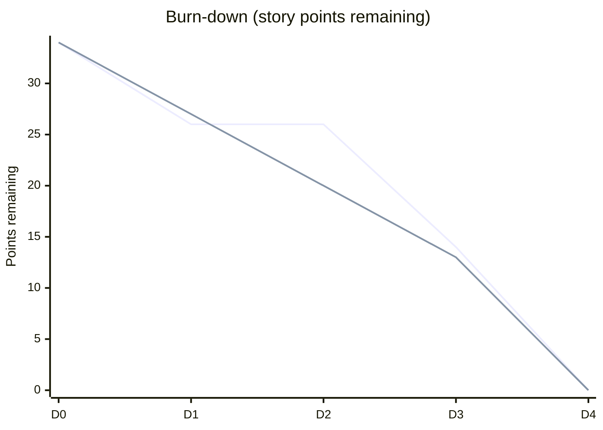

# On-Demand Burn-Down Chart

The user can request a burn-down chart **at any point** during the work — regardless of phase — via
`/update burndown` or a natural-language request. It is a **read-only reporting action: it does not
change phase or state.**

## Data source

Derived from the living plan doc's **timestamped transition log** and the **story-point size** on
each unit (required — set in Plan):

```
remaining effort at time T = total size − Σ size of units closed on or before T
    (total size = sized, non-deferred units only)
```

So the chart plots remaining **effort** (story points), not raw unit count. Any `Unsized` or
**deferred** units are called out **separately** so they don't silently distort the curve.

**If the transition log has been split** into an active table plus a collapsed "Archived
transitions" section (long-running projects archive closed rows to keep the doc cheap to load on
resume — see `living-plan-doc-template.md`), read **both** when computing the curve. The archive
holds real closed-unit history; omitting it would under-count completed effort. This is the one place
that reads the full log — rehydration does not.

**Delegate the full-log read to a haiku subagent.** Because this is the one operation that pulls the
entire transition log (active + archived) — hundreds of rows on a long migration — into context for a
**read-only** report, dispatch a **haiku** agent that reads the log + unit sizes, computes the curve,
and returns **only the rendered chart** (the table + Mermaid + ASCII sparkline below). The raw log
rows then never land in the integrator's context. Running it inline is fine only for a short log (a
few waves).

**Never signal completion prematurely.** If any `Unsized` or deferred unit is still open, annotate
the zero point and do **not** label the run complete — the curve reaching zero reflects only
*sized, executed* effort, not the outstanding work.

## Rendering — markdown-native, zero dependencies

Emit all three, inline in the response and appended to (or refreshed within) the living plan doc:

### 1. Remaining-work-over-time table

| Timestamp | Remaining (pts) | Closed this step | Notes |
|---|---|---|---|
| 2026-08-13T09:00 | 34 | — | plan baseline |
| 2026-08-14T16:20 | 26 | 8 (A, B) | wave 1 converged |
| … | … | … | … |

### 2. Mermaid chart (`xychart-beta`)

Plot the remaining-work curve. When a **velocity** (points-per-two-weeks) was recorded, add an
**ideal trend line** sloping from the start total down to zero at the projected completion date, so
actual-vs-ideal and any ahead/behind gap are visible. Omit the ideal line if no velocity was given.

**Projected completion:** `days_to_complete = total_pts ÷ (velocity_pts ÷ 14)` (where `total_pts`
counts sized, non-deferred units only), in **calendar days**, anchored at the **first Execute
dispatch** (the first transition-log entry). The ideal line
always spans start → that projected date.

**Mid-run rendering:** the **actual line ends at the latest transition** — do **not** fabricate
future actual points. Mid-run it simply stops at "now" while the ideal line continues to the
projection; the two lines need not be the same length.



(First line = actual; second line = ideal from velocity.)

### 3. ASCII sparkline fallback

For terminals/viewers that don't render Mermaid:

```
34 ┤●
26 ┤ ●───●
14 ┤       ●
 0 ┤          ●
   └──────────────
   D0  D1  D2  D3  D4
```

## Ticket links

Each work unit's row/label links to its **matched tracking ticket** when a ticket ref is recorded
(markdown link to the ticket URL). Units with no matched ticket are shown plainly and annotated
`(no ticket)`. Add a short legend below the chart listing open units with their ticket links and
current state.

## Empty / no-data cases

- **No tickets:** the chart still renders from unit sizes; ticket-link columns are omitted.
- **Empty transition log** (requested during Assess/Plan before any unit has closed): report the
  **planned total** and note that burn-down begins once Execute starts. **Do not draw an empty
  curve.**

Chart generation is bundled and dependency-free. If a charting/visualization skill happens to be
present it may be used, but the markdown-native rendering is always available.
